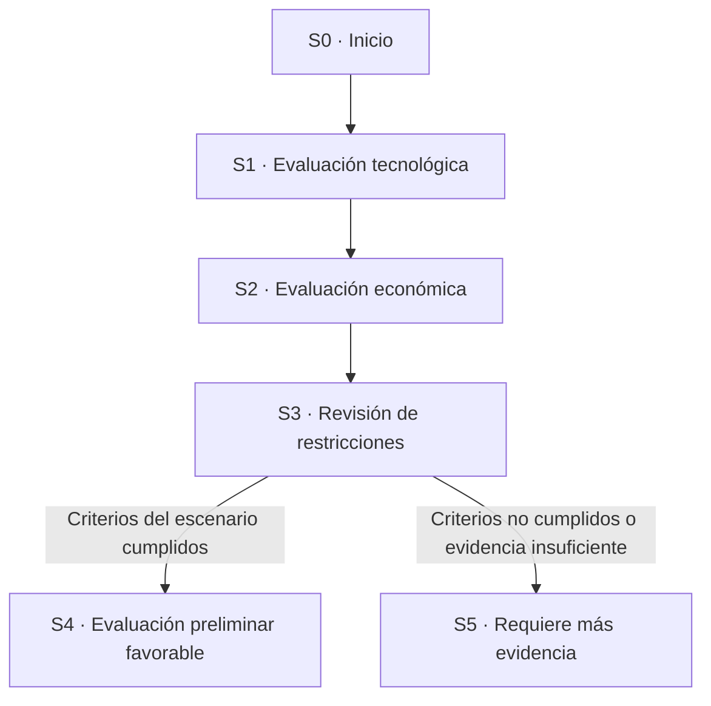

# Espacio de estados: evaluación de una misión hipotética

## Objetivo

Representar una secuencia de evaluación que ayude a identificar qué información se necesita antes de considerar una misión minera. El modelo es conceptual y no certifica la viabilidad de una misión real.

## Componentes

- **Estado inicial:** misión aún no evaluada.
- **Evaluación tecnológica:** revisión hipotética de la preparación tecnológica.
- **Evaluación económica:** cálculo de resultados a partir de supuestos ingresados.
- **Revisión de restricciones:** revisión de condiciones técnicas, económicas, ambientales y regulatorias.
- **Resultado:** evaluación preliminar condicionada a los supuestos.

## Estados

| Código | Estado | Descripción |
|---|---|---|
| S0 | Inicio | No se ha evaluado la misión. |
| S1 | Tecnología revisada | Se ha marcado si la tecnología cumple el umbral hipotético. |
| S2 | Economía calculada | Se calcula el beneficio esperado según los supuestos. |
| S3 | Restricciones revisadas | Se comprueban las restricciones seleccionadas. |
| S4 | Evaluación preliminar favorable | Se cumplen los criterios del modelo didáctico. |
| S5 | Requiere más evidencia | Alguna condición no se cumple o faltan datos. |

## Operadores

1. `evaluar_tecnologia`: S0 → S1.
2. `calcular_economia`: S1 → S2.
3. `revisar_restricciones`: S2 → S3.
4. `clasificar_resultado`: S3 → S4 o S5.

## Restricciones conceptuales

- La probabilidad de éxito debe estar entre 0 y 1.
- El costo y los ingresos hipotéticos no pueden ser negativos.
- Un escenario solo recibe una clasificación preliminar favorable si supera los umbrales elegidos en la simulación.
- Si los datos de entrada son hipotéticos, el resultado también es hipotético.
- No se afirma que las restricciones seleccionadas sean requisitos legales o técnicos reales: son reglas del modelo académico.

## Diagrama

## Interpretación

El espacio de estados convierte un problema amplio en pasos verificables. Los operadores indican qué evaluación se ejecuta; las restricciones determinan si una transición puede producir una clasificación favorable. Los resultados dependen de las reglas y supuestos introducidos por el usuario.
