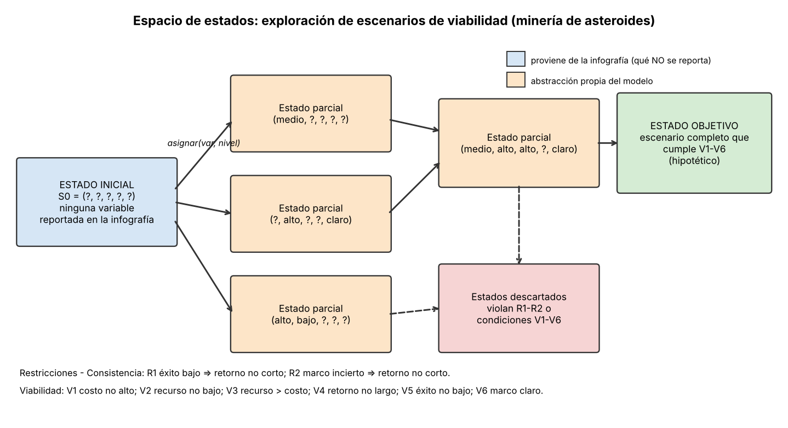
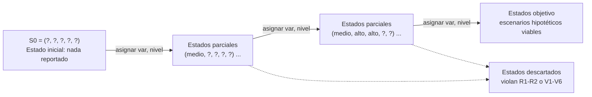

# Entregable 2 — Espacio de estados

Modelo conceptual para explorar escenarios de viabilidad económica de la minería de asteroides.

## 1. Qué viene de la infografía y qué es abstracción

| Elemento | Origen |
|---|---|
| Lista de incertidumbres: costos de extracción, rentabilidad, cantidad y concentración de minerales, tiempo de retorno, probabilidad de éxito técnico, marco regulatorio, impacto ambiental y geopolítico | **Infografía** (sección 6, "aspectos no reportados") |
| Mercado 2026 y 2030, CAGR 21,4 %, 3.143 lanzamientos en 2023 | **Infografía** (no entran como variables de estado) |
| Variables discretas, sus niveles (alto/medio/bajo, etc.) | **Abstracción propia** |
| Estado inicial, estado objetivo, operadores, restricciones numéricas | **Abstracción propia** |

Los niveles y las reglas son supuestos didácticos. **No son datos de la infografía ni valores reales.**

## 2. Variables y niveles (abstracción)

| Variable | Niveles posibles | Relación con la infografía |
|---|---|---|
| `costo_extraccion` | alto, medio, bajo | Costos reales de extracción (no reportado) |
| `recurso` | bajo, medio, alto | Cantidad y concentración de minerales (no reportado) |
| `exito_tecnico` | bajo, medio, alto | Probabilidad de éxito técnico (no reportado) |
| `retorno_inversion` | largo, medio, corto | Tiempo de retorno de inversión (no reportado) |
| `marco_regulatorio` | incierto, claro | Marco regulatorio y legal (no reportado) |

Cada variable puede estar además en estado **desconocido** (`?`).

## 3. Estados

Un estado es una tupla de 5 valores, cada uno un nivel o `?`.

- **Estado inicial** `S0 = (?, ?, ?, ?, ?)`: la infografía no reporta ninguna de las cinco variables, así que ninguna está determinada.
- **Estados intermedios**: asignaciones parciales, por ejemplo `(medio, ?, alto, ?, claro)`.
- **Estado objetivo**: estado completo (sin `?`), consistente, que cumple todas las condiciones de viabilidad. Es un **escenario hipotético**, no una afirmación sobre la realidad.

## 4. Operadores

`asignar(variable, nivel)`: fija una variable desconocida a uno de sus niveles. Representa **adoptar un supuesto** o **conseguir un dato** sobre esa variable. Cada operador tiene costo 1.

## 5. Restricciones

**Consistencia (descartan estados incoherentes):**

- R1. Si `exito_tecnico = bajo`, entonces `retorno_inversion ≠ corto`.
- R2. Si `marco_regulatorio = incierto`, entonces `retorno_inversion ≠ corto`.

**Condiciones de viabilidad (definen el estado objetivo):**

| Tipo | Condición |
|---|---|
| Económica | V1. `costo_extraccion ≠ alto` |
| Económica | V2. `recurso ≠ bajo` |
| Económica | V3. nivel de `recurso` > nivel de `costo_extraccion` (proxy de margen positivo, con bajo=0, medio=1, alto=2) |
| Económica | V4. `retorno_inversion ≠ largo` |
| Técnica | V5. `exito_tecnico ≠ bajo` |
| Regulatoria | V6. `marco_regulatorio = claro` |

Estas condiciones son criterios didácticos; la infografía no fija umbrales.

## 6. Representación textual

## 7. Alcance y limitaciones

El espacio es una simplificación: variables discretas, sin probabilidades ni cantidades monetarias. Que existan estados objetivo solo indica que **hay combinaciones de supuestos** que cumplirían las condiciones, no que sean realistas. Que la infografía no fije ninguna variable indica que la viabilidad **no puede confirmarse con esa fuente**; no prueba inviabilidad. La exploración computacional está en `pipeline_razonamiento.ipynb`.
